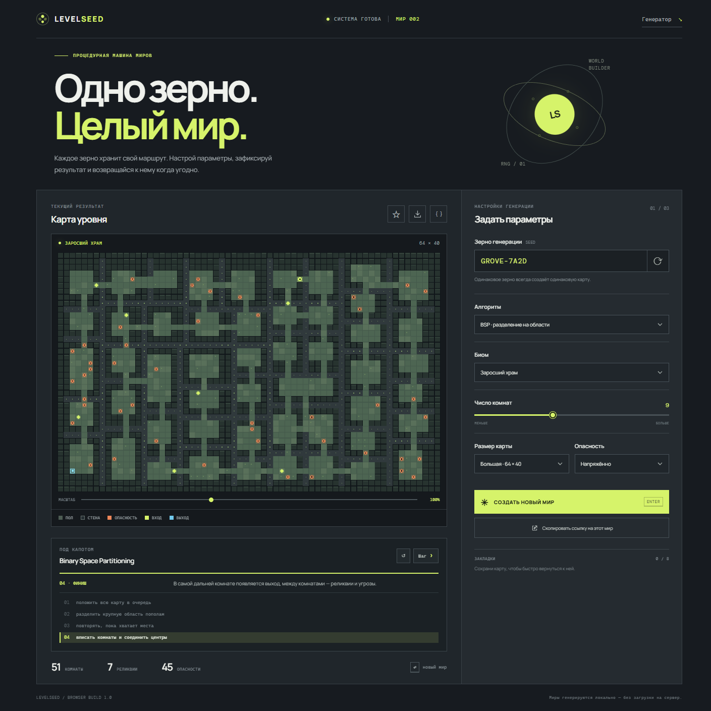

# LevelSeed

**A machine for growing repeatable worlds.** LevelSeed creates deterministic pixel dungeon maps from a seed. Choose how the world is built, watch the algorithm work, then keep the seed to return to exactly the same map.

## Русский

LevelSeed — браузерный генератор процедурных пиксельных подземелий. Он помогает быстро получить карту, настроить её характер и сохранить конкретный вариант для игры или обсуждения.

### Возможности

- Три детерминированных метода с пошаговой визуализацией и строками псевдокода: BSP, клеточный автомат и Random Walk.
- Карты до 256 × 160 клеток (40 960 тайлов), масштабирование и прокрутка.
- Три биома, плотность, уровень опасности и несколько размеров.
- Случайное новое зерно или ручной ввод своего.
- Закладки в локальном хранилище браузера.
- Ссылка с параметрами текущего мира, экспорт изображения в PNG и сетки в JSON.
- Генерация работает локально в браузере; сервер не нужен.

### Как устроены алгоритмы

- **BSP** делит пространство на прямоугольные области, размещает в них комнаты и соединяет комнаты коридорами.
- **Клеточный автомат** создаёт случайное поле скалы, сглаживает его по соседним клеткам и прорезает тоннель между отдельными полостями.
- **Random Walk** прокладывает тропу пошагово, иногда продолжая движение с уже найденного участка, чтобы вырастить боковые ветви.

Во время генерации карта показывает стадии построения, а строка псевдокода, соответствующая текущему этапу, подсвечивается.

### Запуск

Откройте `index.html` в браузере или запустите любой статический HTTP-сервер из этой папки. Зависимостей и сборки нет.

## English

LevelSeed is a browser-based procedural pixel-dungeon generator. It helps you make a map, tune its character, and keep a specific result for a game or a playtest.

### Features

- Three deterministic generators with a step-by-step trace and highlighted pseudocode: BSP, cellular automaton, and Random Walk.
- Maps up to 256 × 160 tiles (40,960 tiles) with zoom and scrolling.
- Three biomes, density, danger, and several map sizes.
- Generate a random seed or enter your own.
- Save bookmarks in the browser's local storage.
- Share a URL containing the current world settings, export a PNG image, or export the tile grid as JSON.
- Everything runs locally in the browser; no server is required.

### How the algorithms work

- **BSP** recursively divides the space into rectangular regions, places rooms inside them, and joins the rooms with corridors.
- **Cellular automaton** seeds random rock, smooths it using neighboring cells, and carves tunnels between separate caves.
- **Random Walk** carves a route one step at a time and occasionally branches from an existing path to grow a connected network.

As a map is generated, its construction stages appear on the canvas and the matching pseudocode line is highlighted.

### Run

Open `index.html` in a browser or serve this folder with any static HTTP server. No dependencies or build step are required.

## Design idea

The interface is a compact game-world instrument rather than a generic admin dashboard. Its seed field acts as the machine's input and the pixel map is the main artifact. Three different algorithms make the construction visible: partitioned rooms, a smoothed cave, and a branching walker trail. The trace panel highlights the matching pseudocode line as each map stage appears. The map can grow to 256 × 160 tiles and export as either an image or reusable JSON data.
